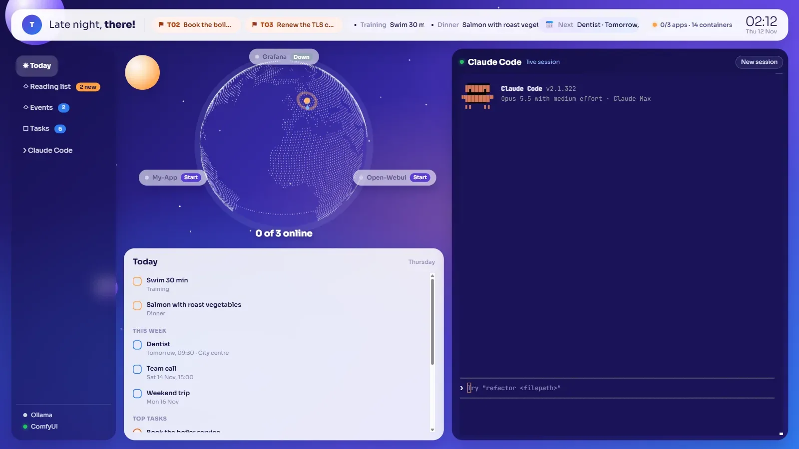

# AI Command Center

One screen for a machine that runs a lot of self-hosted apps. A dotted 3D globe sits in the middle with your apps circling it, the day's plan and tasks sit beside it, and a real Claude Code terminal fills the right half of the window. It runs on `127.0.0.1` only, opens like a desktop app, and never writes to anything except "start this app".



## Why I built it

Once you run a dozen local apps, each in its own Docker Compose stack on its own port, the day turns into tab-juggling: a browser tab per app, one terminal for `docker compose`, another for the coding agent, and nowhere that tells you at a glance what is up and what today holds. I wanted a single window that answers both questions and keeps the agent one click away.

## What you get

| Part | What it does |
|---|---|
| **Fleet globe** | three.js globe drawn from real land data, with a pin for home and optional arcs. Every configured app orbits it: green opens the app, grey starts it with `docker compose up -d`. |
| **Top bar** | Your top three urgent or high-priority tasks as chips, today's plan items, and the next calendar entry. |
| **Today** | Plan and events for the next seven days from `today.json`, plus the top five tasks. |
| **Feeds** | Any number of JSON lists (reading list, events, job alerts, anything) with a **NEW** badge for items that arrived since you last had the page open. |
| **Tasks** | Read from a Markdown task table, sorted Urgent → High → Medium → Low; waiting, blocked and done rows are left out. |
| **Claude Code terminal** | A full Claude Code session (node-pty + xterm.js over a WebSocket) in a folder you choose. It keeps running when you reload the page. |
| **Systems** | Container count from `docker ps`, plus up/down for any extra local services (Ollama, ComfyUI, …). |

## Security model

An embedded terminal is the same as handing over the keyboard, so the guards came first:

- **Loopback only.** The server binds `127.0.0.1`, never `0.0.0.0`. Do not put it behind a reverse proxy or expose it on a LAN.
- **Host allowlist** on every request (stops DNS-rebinding tricks).
- **Origin check** on the WebSocket and on every POST, so another website open in your browser cannot drive it.
- **Per-start secret.** A random token is generated each time the server starts and injected into the page it serves; the API and the terminal socket refuse requests without it, and other origins cannot read it.
- **Strict CSP** (`script-src 'self'`, `frame-ancestors 'none'`), `no-store`, no referrer.
- **One write path.** The only action that changes anything is `docker compose up -d` for an app **name from your config**; nothing the browser sends ends up on a command line.
- **No secrets in the page.** The browser receives your display settings only, never file paths or the terminal configuration.

There is no login: on a single-user desktop the loopback bind plus the per-start token is the gate. That is the right trade-off there and the wrong one anywhere shared.

## Quick start

Requirements: Node.js 22+, Docker (for the fleet panel and Start buttons), and the [Claude Code CLI](https://docs.claude.com/en/docs/claude-code) on your `PATH` if you want the terminal.

```bash
git clone https://github.com/falshaw/ai-command-center.git
cd ai-command-center
npm install
npm start            # runs with the bundled example config
```

Open <http://127.0.0.1:3020>. For an app-style window, use `scripts/start.ps1` (Windows) or `scripts/start.sh` (macOS/Linux), which start the server if needed and open Chrome/Edge in `--app` mode. A desktop shortcut pointing at `start.ps1` makes it a one-click launcher.

## Configuration

Copy the example and edit it; `hud.config.json` is git-ignored.

```bash
cp examples/hud.config.example.json hud.config.json
```

| Key | Meaning |
|---|---|
| `port` | Local port (default 3020). `HUD_PORT` overrides it. |
| `user`, `timezone` | Greeting name and the time zone for clock, dates and "today". |
| `home`, `arcs` | Globe pin (`lat`, `lon`) and optional arcs to other places. |
| `apps[]` | `name`, `port` (or `url`) and optional `composeDir`; without `composeDir` an app shows its status but no Start button. |
| `services[]` | Extra things to ping, e.g. `{ "name": "Ollama", "url": "http://127.0.0.1:11434/api/tags" }`. |
| `todayFile` | JSON with `plan` and `events` (see below). |
| `tasksFile`, `standingTasks` | Markdown task table; IDs in `standingTasks` (routines that are always "in progress") never become top-bar chips. |
| `feeds[]` | `id`, `label`, `file`: each becomes a menu entry. |
| `terminal` | `cwd` (folder the agent starts in) and `command` (default `claude`). |

Relative paths resolve against the config file's folder. Set `HUD_CONFIG=/path/to/file.json` to keep the config elsewhere.

### Data formats

`today.json`

```json
{
  "plan": [{ "label": "Training", "text": "Swim 30 min" }],
  "events": [
    { "title": "Dentist", "location": "City centre", "start": "2026-11-13T09:30:00Z" },
    { "title": "Team call", "inDays": 2, "time": "15:00" }
  ]
}
```

`events` take an ISO `start`, or a relative `inDays` plus local `time` (handy for generated files and demos). Without a time an event counts as all-day.

Task file: a Markdown table under `## Active` with the columns `ID | Area | Task | Priority | Status`. IDs look like `T12`; `**bold**` text in the task cell becomes the title. Priorities understood: Urgent/Critical, High/P1, Medium/P2, Low/P3.

Feed file: a JSON array of `{ "title", "sub"?, "url"?, "score"? (0–100), "firstSeen"? (ISO), "date"? (ISO) }`. Point a script or cron job at it and the page picks up changes every minute.

## How it is built

- **Plain Node, no framework, no bundler.** One server file and three small modules. Edit something in `public/` and reload; edit the server and restart it.
- **Runs on the host, not in Docker**, because it needs to call `docker` and spawn a terminal.
- **Every data source is isolated**: each returns data or an error, so a missing file or a stopped Docker shows "unavailable" in that panel and the rest of the page keeps working.
- **All front-end libraries are served from `node_modules`** (three.js, xterm.js, world-atlas land data); there is no CDN at runtime apart from the Google Fonts stylesheet.

## Honest limits

- Single user, single machine. One terminal session at a time; a second browser tab attaches to the same session.
- It reads files and pings ports; it does not integrate with calendars or task apps directly. Write a small exporter that produces the JSON/Markdown and the page does the rest.
- Starting an app is fire-and-forget `docker compose up -d`; the page re-checks a few times afterwards but does not stream logs.

## License

[MIT](LICENSE)
